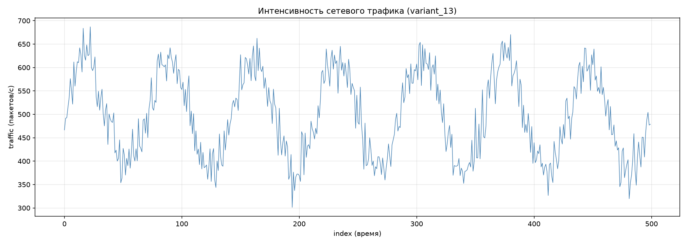
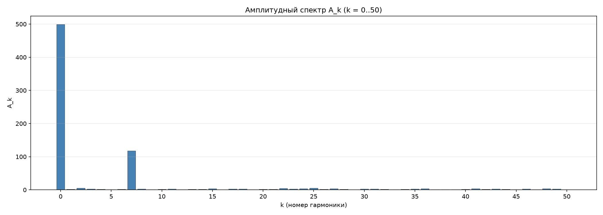
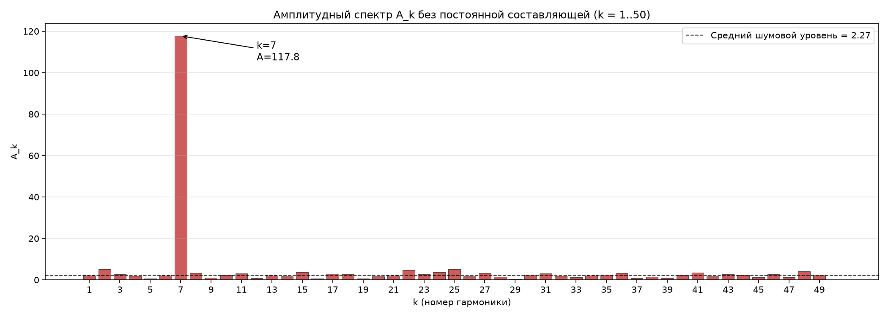
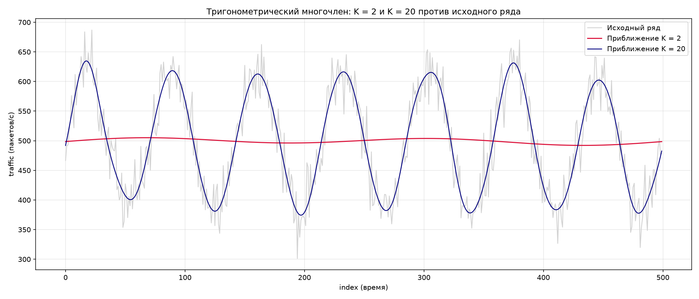

#  Анализ аномалий сетевого трафика методами Фурье

**Учебный проект по математическому анализу**  
Вариант: 13 (500 точек трафика)

---

##  Суть задачи

Представьте, что вы — аналитик SOC и видите перед собой график сетевого трафика за определенный период. Задача — понять: это обычная работа сети или под маскировкой скрывается DDoS-атака, ботнет или утечка данных (скрытый канал)? 

Для этого мы раскладываем сложный сигнал на простые составляющие (гармоники) с помощью **Дискретного преобразования Фурье (ДПФ)**. Реализация — строго «руками», без встроенных функций FFT.

##  Теоретическая часть

### Спектральный анализ

Любой ряд из $N$ точек можно записать как сумму постоянной составляющей и гармоник — синусов и косинусов с частотами $k$ циклов за весь период наблюдения. Спектральный анализ находит, какие гармоники присутствуют в сигнале и насколько они сильны.

### Формулы ДПФ

Для ряда $T(0), T(1), \dots, T(N-1)$:

$$\frac{a_0}{2} = \frac{1}{N}\sum_{j=0}^{N-1} T(j)$$

$$
a_k = \frac{2}{N}\sum_{j=0}^{N-1} T(j)\cos\left(\frac{2\pi k j}{N}\right), \qquad
b_k = \frac{2}{N}\sum_{j=0}^{N-1} T(j)\sin\left(\frac{2\pi k j}{N}\right)
$$

$$A_k = \sqrt{a_k^2 + b_k^2}$$

### Тригонометрический многочлен порядка K

$$T(t) \approx \frac{a_0}{2} + \sum_{k=1}^{K}\left(a_k\cos\frac{2\pi k t}{N} + b_k\sin\frac{2\pi k t}{N}\right)$$

---

##  Шаг 1. Исходные данные и визуальный анализ

Ряд состоит из 500 точек. Первичная статистика:
- **Средний трафик:** 499.29 пакетов/с
- **Минимум:** 301.35
- **Максимум:** 686.88

**Что мы видим глазами:** Ряд имеет ярко выраженную периодичность. На 500 точках укладывается **ровно 7 полных циклов**. Период одной волны составляет около **71.4 точек**. Долговременного тренда (роста или падения) нет.

---

##  Шаг 2. Ручной расчёт коэффициентов (без FFT)

Я реализовал двойной цикл для честного вычисления коэффициентов:
- $a_k$ — отвечает за косинусную составляющую.
- $b_k$ — за синусную.
- $A_k = \sqrt{a_k^2 + b_k^2}$ — итоговая амплитуда гармоники.

**Главная находка:** среди всех 50 гармоник резко выделяется **$k = 7$**.
Её амплитуда **$A_7 = 117.78$**. У всех остальных гармоник амплитуда не превышает 5.3. 

Это значит, что исходный сигнал — почти идеальная синусоида с частотой 7 циклов на весь ряд. Коэффициенты при $k=7$: $a_7 \approx 0.13$, $b_7 \approx 117.78$ (почти чистый синус).

---

##  Шаг 3. Спектральный анализ

На графике спектра видно один гигантский пик на $k=7$. Средний уровень шума по остальным гармоникам — всего **2.27**. 

Превышение главного пика над шумом: **$117.78 / 2.27 \approx 52$ раза!**

В реальном трафике такого «идеального» спектра не бывает. Обычно есть утренние и вечерние пики (что дало бы всплески на кратных частотах 14, 21, 28), но здесь их нет. Сигнал выглядит искусственно.

---

##  Шаг 4. Есть ли здесь аномалия?

По условию задачи, нормальный трафик должен иметь главный пик на $k=1$ (суточный цикл). У нас же $k=1$ находится на уровне шума ($A_1 = 2.13$), а доминирует $k=7$. **Это явная аномалия.**

**Что это может быть?** Зависит от того, чему равна 1 точка по времени:
1. **Если 1 точка = 20 минут** (весь ряд = 7 суток): пик на $k=7$ — это нормальный суточный цикл. Аномалии нет.
2. **Если 1 точка = 1 минута**: период в 71 минуту — это ненормально. Похоже на **скрытый канал** (передача данных всплесками), **ботнет** (маячки «на связь») или **пульсирующую DDoS-атаку**.

Отсутствие «соседних» гармоник подтверждает, что сигнал не естественный.

---

##  Шаг 5. Восстановление ряда (Тригонометрический многочлен)

Я проверил, как справляются модели с порядками K=2 и K=20.

| Порядок K | Ошибка MSE | % необъяснённой дисперсии |
|-----------|------------|---------------------------|
| 2 | 7801.87 | 99.8% |
| 7 (контроль) | 858.22 | 11.0% |
| 20 | 824.81 | 10.6% |

**Вывод:** 
- **K=2** — полностью провальная модель (99.8% ошибки), так как не включает главную гармонику. На графике это просто прямая линия.
- **K=20** — отлично описывает данные (объясняет 89.4% дисперсии).
- **K=7** — дает почти такой же результат (89.0%). Следовательно, наращивать порядок до 20 нет смысла. **Минимально необходимое K = 7.**

Итоговая формула ряда:
$$ T(t) \approx 499.29 + 117.78 \sin\left(\frac{2\pi \cdot 7t}{500}\right) + шум $$

---

##  Итоги работы

1. Исходный ряд не содержит долговременного тренда, но имеет колоссальную периодическую компоненту.
2. Главная гармоника — **$k=7$** (период 71.4 точки), её амплитуда в 52 раза выше шума.
3. Спектр указывает на **искусственный сигнал** (аномалию). Если частота дискретизации — минуты, то это признаки скрытого канала или ботнета.
4. Для описания сигнала достаточно тригонометрического многочлена **порядка K=7**.
