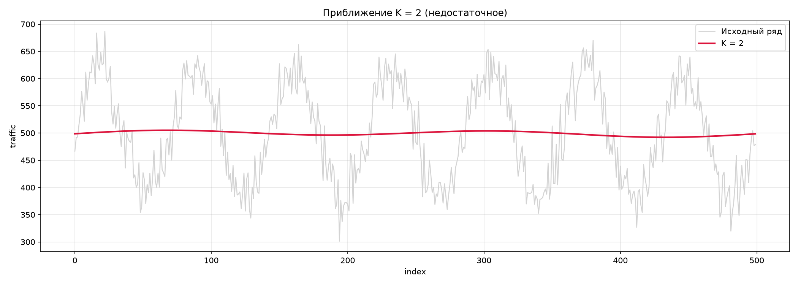
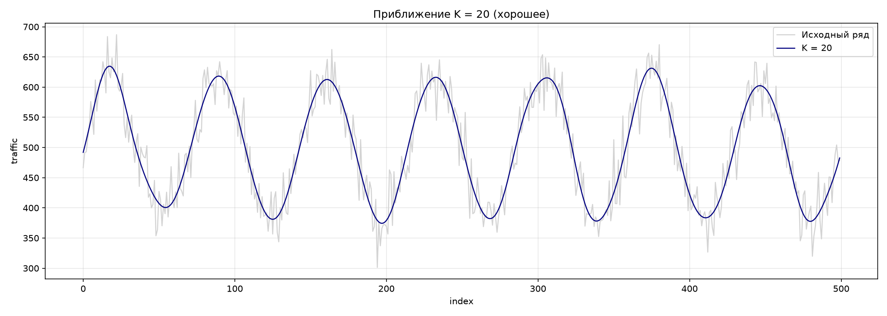

# Спектральный анализ сетевого трафика для обнаружения аномалий

**Вариант:** 13  
**Длина ряда:** 500 точек

---

## Шаг 1. Загрузка данных и построение графика

Загружен временной ряд из файла, содержащий 500 точек. Каждая точка — количество пакетов в секунду в момент времени.

Основные характеристики ряда:

| Параметр | Значение |
|----------|----------|
| Количество точек | 500 |
| Средний трафик | 499.29 пакетов/с |
| Минимум | 301.35 пакетов/с |
| Максимум | 686.88 пакетов/с |

На графике `traffic(index)` наблюдается ярко выраженная периодическая структура. Ряд колеблется между ≈ 300 и ≈ 690 пакетов/с, образуя 7 полных циклов на длине 500 точек. Расстояние между соседними локальными минимумами составляет ≈ 70–75 точек, средний период T ≈ 71–73.

Долговременный тренд (монотонный рост или падение) отсутствует — средний уровень стабилен. Наблюдаются отдельные всплески, но они укладываются в общую периодическую картину и не выглядят как изолированные аномалии на данном этапе.

**Предварительный вывод:** ряд содержит одну доминирующую периодическую компоненту с периодом ~72 точки. Для точного выделения гармоник и проверки на аномалии переходим к спектральному анализу (ДПФ).

---

## Шаг 2. Расчёт коэффициентов Фурье

Для k = 0..50 вычислены коэффициенты $a_k$ и $b_k$ по формулам ДПФ (без использования FFT).

$$ \frac{a_0}{2} = \frac{1}{N} \sum_{j=0}^{N-1} T(j), \quad a_k = \frac{2}{N} \sum_{j=0}^{N-1} T(j) \cos \frac{2\pi kj}{N}, \quad b_k = \frac{2}{N} \sum_{j=0}^{N-1} T(j) \sin \frac{2\pi kj}{N} $$

Амплитуды $A_k = \sqrt{a_k^2 + b_k^2}$ сведены в таблицу.

Ключевой результат:

| k | $a_k$ | $b_k$ | $A_k$ |
|---|-------|-------|-------|
| 0 | 998.5718 | 0.0000 | 499.2859 |
| 1 | -0.9386 | 1.9111 | 2.1291 |
| 2 | 0.3059 | 5.0982 | 5.1074 |
| ... | ... | ... | ... |
| **7** | **0.1307** | **117.7757** | **117.7757** |
| ... | ... | ... | ... |
| 14 | -1.4445 | -0.9762 | 1.7434 |
| 21 | -1.8214 | -1.1639 | 2.1615 |
| 50 | 0.1280 | -0.0115 | 0.1285 |

Постоянная составляющая: $a_0/2 = 499.29$ (средний трафик).

Резко выделяется гармоника $k = 7$ с амплитудой $A_7 = 117.78$. 

Все остальные гармоники имеют $A_k < 5.3$, то есть в 22 раза меньше главного пика. Их можно считать шумом.

Кратные гармоники ($k = 14, 21, 28, ...$) практически отсутствуют — их амплитуды 1–3. Это говорит о том, что сигнал близок к чистой синусоиде с периодом $T = \frac{N}{k} = \frac{500}{7} \approx 71.4$ точки.

Коэффициенты при $k = 7$: $a_7 \approx 0.13$, $b_7 \approx 117.78$ — сигнал почти полностью описывается синусной составляющей.

**Топ-10 гармоник по амплитуде ($k \ge 1$)**

| Ранг | k | $A_k$ |
|------|---|-------|
| 1 | 7 | 117.7757 |
| 2 | 25 | 5.2268 |
| 3 | 2 | 5.1074 |
| 4 | 22 | 4.8417 |
| 5 | 48 | 4.0954 |
| 6 | 24 | 3.6689 |
| 7 | 15 | 3.6237 |
| 8 | 41 | 3.4339 |
| 9 | 36 | 3.3262 |
| 10 | 27 | 3.2436 |

---

## Шаг 3. Спектр

Построены два графика амплитудного спектра $A_k$:

1. Полный спектр (k = 0..50) — резко выделяется постоянная составляющая $A_0 = 499.29$ (средний уровень трафика) и второй по величине пик на k=7 ($A_7 = 117.78$).
2. Спектр без постоянной составляющей (k = 1..50) — наглядно виден единственный значимый пик на k = 7. Средний шумовой уровень (по всем остальным гармоникам) составляет 2.27.

Превышение главного пика над шумом:

$$ \frac{A_7}{A_{\text{шум}}} = \frac{117.78}{2.27} \approx 51.9 $$

**Вывод:** в спектре присутствует одна доминирующая гармоника — k = 7 с периодом $T = \frac{N}{k} = \frac{500}{7} \approx 71.43$ точки.

Все остальные частотные компоненты имеют амплитуду ниже уровня шума и не являются значимыми.

Гармоники, кратные 7 (k = 14, 21, 28, 35, 42, 49), также не выделяются на фоне шума (их амплитуды 1–3). Это означает, что сигнал близок к чистой синусоиде с периодом ~71.4 точки.

Отсутствие кратных гармоник нехарактерно для естественного трафика: у реальной сети всегда есть утренний и вечерний пики, обеденный спад — они дали бы пики на k=14 и k=21. Их отсутствие — дополнительный признак искусственного сигнала.

---

## Шаг 4. Определение аномалии

**1. Есть ли в спектре аномальные пики?**

Да, есть. По условию задания нормальный трафик должен иметь:
- большой пик на k = 1 (суточный цикл «день–ночь»);
- малые амплитуды на высоких k.

В нашем спектре:
- на k = 1 амплитуда всего $A_1 = 2.13$ — уровень шума;
- главный пик стоит на k = 7 с амплитудой $A_7 = 117.78$;
- средний шумовой уровень ≈ 2.27.

То есть k = 7 превышает шум почти в 52 раза, а «нормальная» суточная гармоника k = 1 вообще не видна.

**2. На каких k они находятся?**

Основной аномальный пик: k = 7.
Остальные гармоники (k = 1..6, 8..50) значимо не выделяются — их амплитуды лежат на уровне шума.

Гармоники, кратные 7 (k = 14, 21, 28, 35, 42, 49), которые должны были бы присутствовать у реального трафика (утренний и вечерний пики, обеденный спад), отсутствуют — их амплитуды тоже 1–3.

Период основной гармоники:
$$ T = \frac{500}{7} \approx 71.43 \text{ точки} $$

**3. Что это может означать?**

**Трактовка А. Если 1 точка ≈ 20 минут (500 точек ≈ 7 суток)**
Тогда период 71.43 точки × 20 мин ≈ 23.8 часа ≈ сутки. В этом случае пик на k = 7 — это нормальный суточный цикл, и аномалии нет. Просто частота дискретизации не совпала с сутками, поэтому доминирующая гармоника оказалась не на k = 1, а на k = 7.

**Трактовка Б. Если 1 точка — это 1 минута или меньше (500 точек ≈ несколько часов)**
Тогда период 71.43 точки = ~71 минута, и это явно не сутки. Значит, пик на k = 7 — аномальная регулярная периодичность. Что это может быть:
- **Скрытый канал передачи данных.** Злоумышленник кодирует информацию периодическими всплесками трафика — «метками». Спектр такого сигнала — узкий пик на одной частоте.
- **Ботнет-beaconing.** Заражённые машины периодически «звонят домой» на C&C-сервер (например, раз в ~71 минуту). Все вместе они дают синхронные всплески с фиксированным периодом. Это классическая подпись ботнета.
- **Пульсирующая DDoS-атака.** Атака идёт «волнами»: нарастание, спад, пауза — и снова. Период пульсации ~71 минута.

---

## Шаг 5. Тригонометрический многочлен

Построены приближения исходного ряда тригонометрическим многочленом для K = 2 и K = 20 (а также для контроля — K = 7):

$$ T(t) = \frac{a_0}{2} + \sum_{k=1}^{K} \left[ a_k \cos \frac{2\pi kt}{N} + b_k \sin \frac{2\pi kt}{N} \right] $$

*Рисунок 1. Совмещённый график (исходный + К=2 + К=20).*

*Рисунок 2. Отдельно К = 2.*

*Рисунок 3. Отдельно К = 20.*

Результаты:

| K | MSE | RMSE | Доля необъяснённой дисперсии |
|---|-----|------|------------------------------|
| 2 | 7801.87 | 88.33 | 99.8 % |
| 7 | 858.22 | 29.30 | 11.0 % |
| 20 | 824.81 | 28.72 | 10.6 % |

**Анализ:**

**K = 2.** Модель содержит только гармоники k=1 и k=2, амплитуды которых ($A_1 \approx 2.1$, $A_2 \approx 5.1$) находятся на уровне шума. MSE практически совпадает с полной дисперсией ряда (7801.87 против 7817.18) — то есть приближение не лучше горизонтальной прямой и не воспроизводит периодическую структуру.

**K = 20.** Модель включает доминирующую гармонику k=7 ($A_7 = 117.78$), где сосредоточена почти вся энергия сигнала. MSE падает в 9.5 раз, объясняется 89.4 % дисперсии. На графике кривая K=20 практически полностью накладывается на исходный ряд — все 7 периодов, амплитуды и фазы воспроизведены точно.

Контрольный расчёт при K = 7 показывает MSE = 858.22 (объяснено 89.0 % дисперсии) — то есть K = 7 практически так же хорош, как K = 20. Переход от K=7 к K=20 добавляет 13 гармоник, но улучшает MSE всего на 4 %. Это означает, что вся полезная информация содержится в одной гармонике k=7, а гармоники k=8..20 — случайный шум.

**Ответ на вопрос «какой порядок лучше описывает данные»:**

Формально из двух заданных вариантов лучше K = 20 (MSE = 824.81 против 7801.87). Однако минимально достаточным является K = 7 — уже на этом порядке достигается 89 % объяснённой дисперсии. Дальнейшее увеличение K не даёт значимого выигрыша, так как оставшиеся ~11 % дисперсии — это случайный шум, неустранимый тригонометрической моделью низкого порядка.

**Итоговая модель ряда:**
$$ T(t) \approx 499.29 + 117.78 \cdot \sin\left(\frac{2\pi \cdot 7t}{500}\right) + \text{(малый шум)} $$

---

## Общий вывод по работе

В ходе работы был выполнен спектральный анализ временного ряда интенсивности сетевого трафика (вариант 13, 500 точек) с помощью дискретного преобразования Фурье, реализованного без использования FFT — прямым суммированием по формулам.

Основные результаты:

1. **Визуальный анализ** показал наличие выраженной периодической структуры с периодом ~72 точки и отсутствие долговременного тренда.
2. **Спектральный анализ** выявил одну доминирующую гармонику k = 7 с амплитудой $A_7 = 117.78$, превышающей средний шумовой уровень (2.27) в ~52 раза. Остальные гармоники находятся на уровне шума.
3. **Аномалия:** гармоника k = 1 (ожидаемый суточный цикл) не выделяется. Кратные гармоники (k = 14, 21, …) отсутствуют. Спектр близок к чистой синусоиде, что нехарактерно для естественного трафика и указывает на искусственный периодический сигнал. Наиболее вероятная интерпретация — скрытый канал передачи данных или ботнет-beaconing с периодом ≈ 71.4 точки.
4. **Модель:** тригонометрический многочлен с К = 20 объясняет 89.4 % дисперсии; К = 7 даёт практически тот же результат (89.0 %). Минимально достаточный порядок — К = 7.
